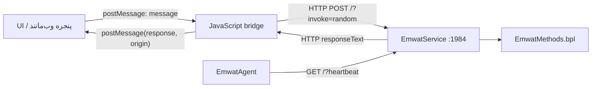

# EMWAT local HTTP bridge — تحلیل مرحله‌ای
آخرین به‌روزرسانی: 2026-11-10
وضعیت سند: یافته‌های ایستا از رشته‌های باینری؛ هنوز runtime-validated نیست.

## 1. شواهد مستقیم

| مورد | شاهد در گزارش | برداشت مجاز |
|---|---|---|
| سرویس HTTP | `TIdHTTPServer`, `TIdCustomHTTPServer`, `FHTTPServer` | سرویس از اجزای سرور HTTP کتابخانه Indy استفاده می‌کند. |
| پورت | پیام `Port binding failed... port 1984 is free` | پورت 1984 در build بررسی‌شده پورت پیش‌فرض/مورد انتظار است. |
| heartbeat | `http://127.0.0.1:1984/?heartbeat` در Agent | Agent برای بررسی وضعیت به loopback و مسیر query-based heartbeat درخواست می‌فرستد. |
| bridge پیام | `POST` به `http://127.0.0.1:$V{myport}?invoke=<random>` | کد JS داده پیام را با POST به سرویس محلی می‌فرستد. |
| پاسخ bridge | `responseText` سپس `postMessage(..., origin)` | پاسخ متنی HTTP به پنجره فرستنده بازگردانده می‌شود. |
| فراخوانی متد | `Emwat method called from`, `TEmwatInvokeParam`, `{EmwatMethod` | مکانیزم dispatch متد در سرویس وجود دارد؛ قرارداد دقیق هنوز استخراج نشده است. |
| init script | `Emwat init script requested from` و XML دارای `<emwat version="1.0">` | سرویس احتمالاً اسکریپت/تعریف اولیه را به client می‌دهد؛ endpoint دقیق نامشخص است. |
| تنظیمات | `Software\\Emwat\\Dynamic Config` | بخشی از تنظیمات پویا در Registry ویندوز نگهداری می‌شود. |

## 2. مدل ارتباطی موقت

این نمودار معماری استنباطی از رشته‌ها را نشان می‌دهد؛ ترتیب دقیق، مسیرهای دیگر و اینکه UI دقیقاً کدام موتور مرورگر را به‌کار می‌برد هنوز اثبات نشده‌اند.

## 3. قرارداد API که هنوز نامعلوم است

- آیا heartbeat از GET استفاده می‌کند و پاسخ موفق چه body/statusی دارد؟
- درخواست invoke چه encoding دارد: UTF-8، ANSI، JSON، XML یا فرم؟
- پارامتر random صرفاً شناسه/ضد-cache است یا در dispatch نقش دارد؟
- پاسخ خطا و موفقیت چه قالبی دارد؟
- آیا endpointهای دیگری برای init script، settings، logging و file transfer وجود دارند؟
- آیا origin، host، token، session یا امضای درخواست بررسی می‌شود؟
- محدودسازی اتصال به loopback در سطح bind انجام می‌شود یا فقط URL از 127.0.0.1 استفاده می‌کند؟
- آیا Agent درخواست heartbeat را دوره‌ای تکرار می‌کند و سیاست restart/terminate چیست؟

## 4. نکات امنیتی برای بازطراحی

نسخه Linux نباید صرفاً یک HTTP listener باز روی همه interfaceها بسازد. طراحی اولیه باید:
1. فقط روی loopback bind شود.
2. از یک پورت تصادفی/قابل تخصیص استفاده کند؛ اگر سازگاری با 1984 لازم است، اشغال بودن پورت مدیریت شود.
3. برای invoke از token تصادفی session-bound یا مکانیزم احراز هویت محلی استفاده کند.
4. payload را با محدودیت اندازه و timeout دریافت کند.
5. origin را به‌تنهایی مرز امنیتی تلقی نکند.
6. از ثبت اطلاعات حساس در log خودداری کند.
7. endpointهای heartbeat و invoke را از نظر method، status code و content type صریح تعریف کند.

این موارد توصیه طراحی برای نسخه جدید هستند، نه ادعایی درباره امنیت نسخه Windows.

## 5. اقدام بعدی برای اثبات رفتار

### A. تحلیل Import Table
برای فایل‌های زیر، فهرست DLL و APIهای واردشده را استخراج کن:
- `D:\EmwatInstaller\EmwatService.exe`
- `D:\EmwatInstaller\EmwatAgent.exe`
- `D:\EmwatInstaller\EmwatMethods.bpl1`

به‌طور خاص دنبال این خانواده‌ها هستیم:
- شبکه: `bind`, `listen`, `accept`, `recv`, `send`, `connect`, `WinHttp*`, `Internet*`, `WSA*`
- سرویس و process: `CreateService*`, `OpenSCManager*`, `StartService*`, `CreateProcess*`
- مرورگر/COM: `CoCreateInstance`, `IWebBrowser2`, `WebView`, `ShellExecute*`
- دیتابیس: `SQLAllocHandle`, `SQLDriverConnect`, `sqlite3_*`, `mysql_*`, `PQ*`, `FireDAC` و نام DLLهای driver
- فایل و رمزنگاری: `CreateFile*`, `Crypt*`, `BCrypt*`

### B. آماده‌سازی ابزار
اگر Visual Studio Build Tools نصب است، در Developer PowerShell دستور `dumpbin /imports <file>` را اجرا کن. در غیر این صورت از ابزار PE-bear یا Dependencies برای نمایش Import Table استفاده کن. ابزار جدید را فقط از منبع رسمی دریافت کن.

### C. خروجی قابل ارسال
Importها را در فایل‌های TXT ذخیره کن و در مخزن قرار بده. لازم نیست کل خروجی را در چت paste کنی. پیش از commit، مسیرهای شخصی، نام کاربری، URLهای خصوصی، tokenها و داده‌های مشتریان را بازبینی و حذف کن.

## 6. نتیجه فعلی
با اطمینان بالا، وجود سرویس HTTP محلی و bridge پیام در build بررسی‌شده تأیید می‌شود. اما هنوز نمی‌توان endpointهای کامل، پروتکل payload، دیتابیس، احراز هویت یا UI engine را قطعی اعلام کرد. پیاده‌سازی API لینوکس باید تا زمان دریافت Import Table و شواهد runtime در حد طراحی بماند.

## مشاهده runtime توسط کاربر — درخواست invoke (2026-11-12)

کاربر در Firefox Developer Tools یک درخواست واقعی از اتوماسیون را مشاهده و URL آن را کپی کرد:

- Method: `POST` (گزارش مستقیم کاربر)
- URL: `http://127.0.0.1:1984/?invoke=83011` (URL کپی‌شده از درخواست)
- Caller page / Referer گزارش‌شده: `automation.bsi.ir/secretariat/ClientSingleton.do`
- Origin نیز در پنل Headers دیده شده، اما مقدار آن هنوز ارائه نشده است.

این مشاهده، استفاده واقعی از endpoint ریشه روی loopback و query پارامتر `invoke` را برای دست‌کم یک عملیات تأیید می‌کند. مقدار `83011` فقط برای همین درخواست مشاهده شده است؛ هنوز معلوم نیست شناسه ثابت متد، شناسه تصادفی/هم‌بستگی یا مقدار دیگری باشد. این مشاهده به‌تنهایی body، encoding، پاسخ یا معنای عملیات را مشخص نمی‌کند.

### گام بعدی برای همان درخواست

در Firefox، جزئیات همان درخواست را باز کرده و بخش Request / Request body (در صورت نمایش) را بررسی کن؛ همچنین Response و Request Headers شامل Content-Type را ثبت کن. پیش از اشتراک‌گذاری، Cookie، Authorization، token، داده‌های نامه و اطلاعات شخصی را حذف کن. اگر UI گزینه Copy as cURL دارد، خروجی را فقط پس از پاک‌سازی headerهای محرمانه ارسال کن.

## مشاهده runtime از HAR — فراخوانی EditWordDocument (2026-11-12)

کاربر فایل HAR خروجی Firefox 158 را از نشست اتوماسیون ارائه کرد. این فایل دو درخواست مجزا به سرویس محلی را نشان می‌دهد:

### درخواست اول
- POST http://127.0.0.1:1984/?invoke=83011
- در HAR برای این درخواست body ثبت نشده و status برابر 0 است؛ بنابراین این رکورد به‌تنهایی برای تعیین عملیات یا پاسخ کافی نیست.

### درخواست دوم
- POST http://127.0.0.1:1984/?invoke=92123
- Content-Type: text/plain;charset=UTF-8
- Content-Length: 1391942 (حدود 1.39 MB)
- بدنه با XML شامل emwat version="1.0" و method class="EditWordDocument" آغاز می‌شود.
- درون پارامتر wordConfig، یک سند XML با encoding از نوع Base64 قرار گرفته است.
- بخش قابل decode شده از wordConfig با <word-document status="view" viewMode="protected"> آغاز می‌شود.
- در همین نمونه، permissionها allowPrint=false، allowCopy=false و allowSave=false هستند و setting با نام gam-print-dialog مقدار false دارد.
- fieldهای قابل مشاهده شامل metadata مربوط به امضاها، شماره/تاریخ ثبت نامه، نام نماینده امضاکننده، شماره امضاها، QR/barcode، گیرندگان و گیرندگان رونوشت هستند. چند field تصویری mimetype="image/*" و encryption="base64" دارند؛ مقادیر واقعی و محتوای تصویر در این سند عمداً ثبت نمی‌شوند.
- برای این درخواست نیز HAR status برابر 0 و response body خالی ثبت کرده است؛ این به‌تنهایی مشخص نمی‌کند که سرویس پاسخ نداده، درخواست هنوز pending بوده یا پاسخ در HAR ثبت نشده است.

### محدودیت شواهد
HAR مقدار Content-Length برابر 1,391,942 را گزارش می‌کند، اما postData.text در export روی 1,048,576 بایت متوقف شده است. بنابراین بدنه ارسالی ناقص است و انتهای XML/پارامترها در دسترس نیست. این نمونه یک پیام واقعی EditWordDocument را اثبات می‌کند، اما چون document status برابر view و viewMode برابر protected است، هنوز نمونه چرخه ویرایش/ذخیره نیست.

### نتیجه و گام بعد
- اتصال مرورگر به endpoint محلی و dispatch کلاس EditWordDocument اکنون با شاهد runtime تأیید شده است.
- wordConfig یک XML سند است که به‌صورت Base64 داخل پارامتر XML بیرونی حمل می‌شود؛ برخی fieldها نیز payload تصویری Base64 دارند.
- invoke در این دو نمونه مقادیر متفاوت 83011 و 92123 دارد؛ نقش دقیق آن همچنان نامشخص است.
- گام بعدی: ثبت trace کامل و پاک‌سازی‌شده از باز کردن یک نامه قابل ویرایش و سپس تغییر/بستن آن، با capture کامل request و response. از آنجا که HAR فعلی ممکن است داده محرمانه نامه/تصاویر و کوکی نشست داشته باشد، فایل خام نباید در مخزن عمومی commit شود.
