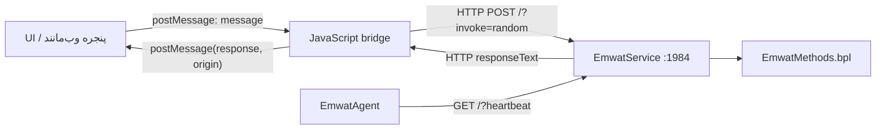

# EMWAT local HTTP bridge — تحلیل مرحله‌ای
آخرین به‌روزرسانی: 2026-11-10
وضعیت سند: ترکیب یافته‌های ایستا و runtime-validated از capture مورخ 2026-11-15.

## 1. شواهد مستقیم

| مورد | شاهد در گزارش | برداشت مجاز |
|---|---|---|
| سرویس HTTP | `TIdHTTPServer`, `TIdCustomHTTPServer`, `FHTTPServer` | سرویس از اجزای سرور HTTP کتابخانه Indy استفاده می‌کند. |
| پورت | پیام `Port binding failed... port 1984 is free` | پورت 1984 در build بررسی‌شده پورت پیش‌فرض/مورد انتظار است. |
| heartbeat | `GET /?heartbeat` در capture | پاسخ runtime برابر `200 OK` با body دقیق `TickTack` (۸ بایت) است. |
| bridge پیام | `POST /?invoke=<random>` در capture | درخواست UTF-8 با `Content-Type: text/plain;charset=UTF-8` به سرویس loopback ارسال می‌شود؛ body یک envelope XML با root `emwat version="1.0"` است. |
| پاسخ bridge | `responseText` سپس `postMessage(..., origin)` و capture stream 18 | پاسخ موفق `response-word status="success"` با `return-types/type` و MIME برابر `application/msword` و Base64 است. |
| فراخوانی متد | `Emwat method called from`, `TEmwatInvokeParam`, `{EmwatMethod` | مکانیزم dispatch متد در سرویس وجود دارد؛ قرارداد دقیق هنوز استخراج نشده است. |
| init script | `GET /?init=<عدد>_<عدد>` در capture | پاسخ `200 OK` حاوی HTML/JavaScript bridge است؛ Referer درخواست به صفحهٔ Almas اشاره می‌کند. |
| تنظیمات | `Software\\Emwat\\Dynamic Config` | بخشی از تنظیمات پویا در Registry ویندوز نگهداری می‌شود. |

## 2. مدل ارتباطی موقت



این نمودار معماری استنباطی از رشته‌ها را نشان می‌دهد؛ ترتیب دقیق، مسیرهای دیگر و اینکه UI دقیقاً کدام موتور مرورگر را به‌کار می‌برد هنوز اثبات نشده‌اند.

## 3. قرارداد API که هنوز نامعلوم است

- heartbeat پاسخ runtime مشخص دارد؛ تناوب دقیق و سیاست timeout/restart Agent هنوز باید از captureهای بیشتر/کد Agent استخراج شود.
- encoding درخواست invoke در نمونهٔ ثبت‌شده UTF-8 است؛ رفتار نسخه‌ها و encoding پاسخ خطا هنوز باید بررسی شود.
- پارامتر random صرفاً شناسه/ضد-cache است یا در dispatch نقش دارد؟
- قالب پاسخ موفق EditWordDocument در capture مشخص است؛ قالب پاسخ خطا و پاسخ سایر متدها هنوز کامل نیست.
- endpoint init و heartbeat و invoke در capture مشاهده شده‌اند؛ وجود endpointهای دیگر برای settings، logging و file transfer هنوز نامعلوم است.
- آیا origin، host، token، session یا امضای درخواست بررسی می‌شود؟
- محدودسازی اتصال به loopback در سطح bind انجام می‌شود یا فقط URL از 127.0.0.1 استفاده می‌کند؟
- آیا Agent درخواست heartbeat را دوره‌ای تکرار می‌کند و سیاست restart/terminate چیست؟

## 4. نکات امنیتی برای بازطراحی

نسخه Linux نباید صرفاً یک HTTP listener باز روی همه interfaceها بسازد. طراحی اولیه باید:
1. فقط روی loopback bind شود.
2. از یک پورت تصادفی/قابل تخصیص استفاده کند؛ اگر سازگاری با 1984 لازم است، اشغال بودن پورت مدیریت شود.
3. برای invoke از token تصادفی session-bound یا مکانیزم احراز هویت محلی استفاده کند.
4. payload را با محدودیت اندازه و timeout دریافت کند.
5. origin را به‌تنهایی مرز امنیتی تلقی نکند.
6. از ثبت اطلاعات حساس در log خودداری کند.
7. endpointهای heartbeat و invoke را از نظر method، status code و content type صریح تعریف کند.

این موارد توصیه طراحی برای نسخه جدید هستند، نه ادعایی درباره امنیت نسخه Windows.

## 5. اقدام بعدی برای اثبات رفتار

### A. تحلیل Import Table
برای فایل‌های زیر، فهرست DLL و APIهای واردشده را استخراج کن:
- `D:\EmwatInstaller\EmwatService.exe`
- `D:\EmwatInstaller\EmwatAgent.exe`
- `D:\EmwatInstaller\EmwatMethods.bpl1`

به‌طور خاص دنبال این خانواده‌ها هستیم:
- شبکه: `bind`, `listen`, `accept`, `recv`, `send`, `connect`, `WinHttp*`, `Internet*`, `WSA*`
- سرویس و process: `CreateService*`, `OpenSCManager*`, `StartService*`, `CreateProcess*`
- مرورگر/COM: `CoCreateInstance`, `IWebBrowser2`, `WebView`, `ShellExecute*`
- دیتابیس: `SQLAllocHandle`, `SQLDriverConnect`, `sqlite3_*`, `mysql_*`, `PQ*`, `FireDAC` و نام DLLهای driver
- فایل و رمزنگاری: `CreateFile*`, `Crypt*`, `BCrypt*`

### B. آماده‌سازی ابزار
اگر Visual Studio Build Tools نصب است، در Developer PowerShell دستور `dumpbin /imports <file>` را اجرا کن. در غیر این صورت از ابزار PE-bear یا Dependencies برای نمایش Import Table استفاده کن. ابزار جدید را فقط از منبع رسمی دریافت کن.

### C. خروجی قابل ارسال
Importها را در فایل‌های TXT ذخیره کن و در مخزن قرار بده. لازم نیست کل خروجی را در چت paste کنی. پیش از commit، مسیرهای شخصی، نام کاربری، URLهای خصوصی، tokenها و داده‌های مشتریان را بازبینی و حذف کن.

## 6. نتیجه فعلی
با اطمینان بالا، وجود سرویس HTTP محلی و bridge پیام در build بررسی‌شده تأیید می‌شود. اما هنوز نمی‌توان endpointهای کامل، پروتکل payload، دیتابیس، احراز هویت یا UI engine را قطعی اعلام کرد. پیاده‌سازی API لینوکس باید تا زمان دریافت Import Table و شواهد runtime در حد طراحی بماند.


## مشاهده runtime توسط کاربر — درخواست invoke (2026-11-12)

کاربر در Firefox Developer Tools یک درخواست واقعی از اتوماسیون را مشاهده و URL آن را کپی کرد:

- Method: `POST` (گزارش مستقیم کاربر)
- URL: `http://127.0.0.1:1984/?invoke=83011` (URL کپی‌شده از درخواست)
- Caller page / Referer گزارش‌شده: `automation.bsi.ir/secretariat/ClientSingleton.do`
- Origin نیز در پنل Headers دیده شده، اما مقدار آن هنوز ارائه نشده است.

این مشاهده، استفاده واقعی از endpoint ریشه روی loopback و query پارامتر `invoke` را برای دست‌کم یک عملیات تأیید می‌کند. مقدار `83011` فقط برای همین درخواست مشاهده شده است؛ هنوز معلوم نیست شناسه ثابت متد، شناسه تصادفی/هم‌بستگی یا مقدار دیگری باشد. این مشاهده به‌تنهایی body، encoding، پاسخ یا معنای عملیات را مشخص نمی‌کند.

### گام بعدی برای همان درخواست

در Firefox، جزئیات همان درخواست را باز کرده و بخش Request / Request body (در صورت نمایش) را بررسی کن؛ همچنین Response و Request Headers شامل Content-Type را ثبت کن. پیش از اشتراک‌گذاری، Cookie، Authorization، token، داده‌های نامه و اطلاعات شخصی را حذف کن. اگر UI گزینه Copy as cURL دارد، خروجی را فقط پس از پاک‌سازی headerهای محرمانه ارسال کن.


## مشاهده runtime از HAR — فراخوانی EditWordDocument (2026-11-12)

کاربر فایل HAR خروجی Firefox 158 را از نشست اتوماسیون ارائه کرد. این فایل دو درخواست مجزا به سرویس محلی را نشان می‌دهد:

### درخواست اول
- POST http://127.0.0.1:1984/?invoke=83011
- در HAR برای این درخواست body ثبت نشده و status برابر 0 است؛ بنابراین این رکورد به‌تنهایی برای تعیین عملیات یا پاسخ کافی نیست.

### درخواست دوم
- POST http://127.0.0.1:1984/?invoke=92123
- Content-Type: text/plain;charset=UTF-8
- Content-Length: 1391942 (حدود 1.39 MB)
- بدنه با XML شامل emwat version="1.0" و method class="EditWordDocument" آغاز می‌شود.
- درون پارامتر wordConfig، یک سند XML با encoding از نوع Base64 قرار گرفته است.
- بخش قابل decode شده از wordConfig با <word-document status="view" viewMode="protected"> آغاز می‌شود.
- در همین نمونه، permissionها allowPrint=false، allowCopy=false و allowSave=false هستند و setting با نام gam-print-dialog مقدار false دارد.
- fieldهای قابل مشاهده شامل metadata مربوط به امضاها، شماره/تاریخ ثبت نامه، نام نماینده امضاکننده، شماره امضاها، QR/barcode، گیرندگان و گیرندگان رونوشت هستند. چند field تصویری mimetype="image/*" و encryption="base64" دارند؛ مقادیر واقعی و محتوای تصویر در این سند عمداً ثبت نمی‌شوند.
- برای این درخواست نیز HAR status برابر 0 و response body خالی ثبت کرده است؛ این به‌تنهایی مشخص نمی‌کند که سرویس پاسخ نداده، درخواست هنوز pending بوده یا پاسخ در HAR ثبت نشده است.

### محدودیت شواهد
HAR مقدار Content-Length برابر 1,391,942 را گزارش می‌کند، اما postData.text در export روی 1,048,576 بایت متوقف شده است. بنابراین بدنه ارسالی ناقص است و انتهای XML/پارامترها در دسترس نیست. این نمونه یک پیام واقعی EditWordDocument را اثبات می‌کند، اما چون document status برابر view و viewMode برابر protected است، هنوز نمونه چرخه ویرایش/ذخیره نیست.

### نتیجه و گام بعد
- اتصال مرورگر به endpoint محلی و dispatch کلاس EditWordDocument اکنون با شاهد runtime تأیید شده است.
- wordConfig یک XML سند است که به‌صورت Base64 داخل پارامتر XML بیرونی حمل می‌شود؛ برخی fieldها نیز payload تصویری Base64 دارند.
- invoke در این دو نمونه مقادیر متفاوت 83011 و 92123 دارد؛ نقش دقیق آن همچنان نامشخص است.
- گام بعدی: ثبت trace کامل و پاک‌سازی‌شده از باز کردن یک نامه قابل ویرایش و سپس تغییر/بستن آن، با capture کامل request و response. از آنجا که HAR فعلی ممکن است داده محرمانه نامه/تصاویر و کوکی نشست داشته باشد، فایل خام نباید در مخزن عمومی commit شود.


## مشاهده runtime چرخه بستن سند قابل ویرایش — 2026-11-12

کاربر یک نامه قابل ویرایش را در سامانه باز کرد و در Firefox Network درخواست‌های مرتبط را بررسی کرد:

- درخواست مشاهده‌شده به `127.0.0.1:1984` از نوع `POST` و دارای `Content-Type: text/plain;charset=UTF-8` بود؛ مقدار query برابر `invoke=5208` گزارش شد.
- در زمان باز بودن سند، تغییر متن و سپس فشردن `Ctrl+S` درخواست جدیدی به پورت 1984 ایجاد نکرد.
- هنگام بستن سند، یک `POST` به همان endpoint با همان مقدار گزارش‌شده `invoke=5208` دیده شد؛ این درخواست HTTP status برابر 200 داشت و Response آن XML بود.
- ابتدای Response به‌صورت `<?xml version="1.0" encoding="utf-8" ?><emwat version="1.0"><method class="EditWordDocument"><param name="wordConfig">` گزارش شد.
- کاربر در ادامه XML تگ‌های `status`، `ErrorCode`، `Returntypes` یا `Error` قابل تشخیصی پیدا نکرد؛ بدنه کامل و ساختار داخلی پاسخ هنوز در دسترس نیست.

### برداشت و محدودیت

این trace runtime نشان می‌دهد که هنگام بستن سند، یک پاسخ HTTP موفق با envelope مربوط به `EditWordDocument` دریافت می‌شود. این یافته با نقش پاسخ در چرخه بستن/بازگشت سند سازگار است، اما به‌تنهایی ثابت نمی‌کند که محتوای ویرایش‌شده در `wordConfig` قرار دارد یا سامانه نامه را نهایی ذخیره کرده است. HTTP 200 فقط موفقیت لایه HTTP را نشان می‌دهد. همچنین نبود درخواست جدید هنگام ویرایش و Ctrl+S فقط برای همین نشست و trace مشاهده‌شده معتبر است؛ ممکن است ذخیره‌سازی در خود برنامه Word/سرویس، timer/autosave یا مسیر دیگری انجام شود.

### گام بعدی

برای تعیین معنای پاسخ، یک trace کامل و پاک‌سازی‌شده از درخواست و پاسخ هنگام بستن یک نامه آزمایشی لازم است؛ به‌ویژه باید اندازه پاسخ، نام تگ‌های بیرونی پس از بسته‌شدن `wordConfig` و تفاوت `wordConfig` درخواست اولیه و پاسخ نهایی مقایسه شود. هیچ متن نامه، تصویر/امضا، Cookie، Authorization یا token نباید در مخزن ثبت شود.


## تکمیل مشاهده Response هنگام بستن Word — مقدار طولانی داخل wordConfig (2026-11-12)

کاربر پس از بررسی بیشتر Response مربوط به POST با `invoke=5208` گزارش کرد که پس از ابتدای XML، یک مقدار طولانیِ کدشده وجود دارد و احتمال می‌دهد متن سند باشد.

- مقدار طولانی در ادامه XML و پس از پارامتر `wordConfig` مشاهده شده است.
- با توجه به trace قبلی که در آن مقدار `wordConfig` درخواست به‌صورت Base64 و حاوی XML داخلی `word-document` بود، یک فرضیه قوی این است که مقدار پاسخ نیز یک payload کدشده از پیکربندی/محتوای سند باشد.
- هنوز مشخص نیست payload پاسخ دقیقاً متن بدنه، XML سند کامل، فایل/محتوای باینری، یا ترکیبی از فیلدها و تنظیمات است. کدگذاری Base64 در Response جدید نیز هنوز با decode کنترل‌شده تأیید نشده است.
- این مقدار نباید در چت یا مخزن عمومی کپی شود؛ ممکن است متن نامه، امضا، تصاویر، شناسه‌ها یا داده محرمانه سازمانی در آن باشد.

### آزمایش امن بعدی

بدون ارسال خود payload، فقط در Firefox مشخص شود آیا مقدار داخل `wordConfig` با `<` شروع می‌شود یا با رشته‌ای شبیه Base64 (حروف/اعداد و احتمالاً `+`, `/`, `=`). اگر Base64 است، در صورت مجازبودن، می‌توان آن را فقط به‌صورت محلی decode کرد و **صرفاً نام تگ ریشه و نام تگ‌های سطح اول** را گزارش داد؛ هیچ متن یا مقدار field نباید کپی یا منتشر شود. سپس باید ساختار درخواست و پاسخ مقایسه شود تا معلوم شود پاسخ واقعاً داده ویرایش‌شده را حمل می‌کند یا صرفاً metadata/configuration است.


## Decode محلی wordConfig در نمونه قابل ویرایش — schema سند (2026-11-12)

پس از مشاهده Response مربوط به POST با `invoke=5208` و HTTP 200، کاربر مقدار کدشده داخل `wordConfig` را به‌صورت محلی decode کرد و ساختار XML داخلی را بررسی کرد. تنها schema و نام فیلدها برای مستندسازی استفاده می‌شود؛ مقادیر واقعی مکاتبه در مخزن ثبت نشده‌اند.

یافته‌های مستقیم از نمونه decodeشده:

- ریشه `word-document` دارای `status="edit"` بود.
- permission برابر `allowPrint=false`، `allowCopy=true` و `allowSave=true` بود.
- بخش‌های سطح بالا شامل `settings`، `fields`، `optional-attributes` و `requested-types` بودند.
- setting مشاهده‌شده `gam-print-dialog=false` بود.
- `optional-attributes` شامل `tokenizedReceivers` با نوع `compInfo` بود؛ content آن URL-encoded بود.
- `requested-types` مقدار MIME برابر `application/msword` داشت.
- فیلدهای متنی هم به‌صورت CDATA ساده و هم با `encryption="urlencoded"` دیده شدند.
- فیلدهای تصویری با `encryption="base64"` و `mimetype="image/*"` تعریف شده بودند؛ از جمله خانواده‌های فیلد امضا، QR و barcode.
- خانواده فیلدهای امضاکننده تا index 19 در schema وجود داشت.
- در همین نمونه decodeشده، عنصر `<body>` دیده نشد؛ این مشاهده نباید به تمام پیام‌ها تعمیم داده شود.

### نتیجه و محدودیت

این داده تأیید می‌کند که payload decodeشده یک مدل سند قابل ویرایش با metadata فیلدها و permissionهاست. بااین‌حال، نبودن `<body>` در همین نمونه، محل بدنه واقعی نامه را روشن نمی‌کند. همچنین `application/msword` فقط MIME type اعلام‌شده در `requested-types` است و به‌تنهایی قالب باینری فایل نهایی را تعیین نمی‌کند.

### گام فنی بعدی

1. ساختار `wordConfig` در request اولیه و response زمان close را بدون مقادیر مقایسه کن.
2. در مسیرهای `LoadDocument` و `PrepareDocument` مشخص کن Body از کجا مقداردهی می‌شود و آیا optional است.
3. callerها و side effectهای `SilentSaveEmwatDoc`، `OnTmrAutoSave` و `WordAppDocumentBeforeClose` را به ترتیب فراخوانی متصل کن.
4. نوع فایل/return payload را از `Wordresponsexml.Returntypes` یا مسیر فایل موقت اثبات کن؛ از روی `requested-types` حدس نزن.

هیچ مقدار شخصی، متن نامه، شناسه مکاتبه، محتوای Base64 تصویر یا داده احراز هویت در این مستند ذخیره نشده است.


## Static bridge script in EmwatService.exe — invoke value is client-generated (2026-11-14)

The embedded JavaScript bridge string was recovered from the `EmwatService.exe` string dump. After deobfuscating its string array, the relevant behavior is:

```javascript
function invoke(event) {
  const origin = event.origin;
  const source = event.source;
  const xhr = new XMLHttpRequest();
  const requestId = Math.floor(Math.random() * 99999);
  xhr.open("POST", "http://127.0.0.1:$V{myport}?invoke=" + requestId);
  xhr.onreadystatechange = function () {
    if (xhr.readyState == 4) source.postMessage(xhr.responseText, origin);
  };
  xhr.send(event.data);
}
window.addEventListener("message", function (event) { invoke(event); }, false);
```

This changes the interpretation of the observed query value:

- **Statically confirmed:** the browser bridge generates a pseudo-random integer for each message invocation using `Math.floor(Math.random()*99999)`, then appends it to the `invoke` query parameter.
- **Statically confirmed:** the request body is the original `message` event's `data`; the response text is sent back to the originating frame/window using `postMessage(responseText, origin)`.
- **Runtime-confirmed:** user HAR/DevTools observations show XML envelopes such as `<method class="EditWordDocument">`; a close-time request was observed with `invoke=5208`.
- **Corrected interpretation:** `5208` is not a stable operation ID or a hard-coded EditWordDocument method number. It is a client-generated request identifier for that POST. The method identity is carried in the XML body (for example, `method class="EditWordDocument"`).
- **Unknown:** whether the service uses the random value only for correlation/logging or also as an internal request key; uniqueness, collision handling and server-side storage semantics have not yet been recovered.

The service string dump also contains `TEmwatInvokeParam`, `ParseMethod`, `Calling ParseMethod exception:`, `Emwat method called from`, and `Unable to call "invoke" method:`. These strings support a service-side parse/invoke path, but without the service executable's disassembly they do not establish the parser's exact implementation or error handling.

### Revised next steps

1. Trace the service-side request parser and `ParseMethod` path; treat `invoke` as a per-request random value, not a static method registry key unless server code proves otherwise.
2. Trace the XML `method class` dispatch from `EditWordDocument` to the corresponding `TEmwatMethod`/connector implementation.
3. Determine how the random query value is used (correlation, request map, logging, or another purpose) from service code or runtime traces.
4. Connect the close-time request/response to the document extraction and apply/return behavior. Do not infer that `5208` identifies the operation.


## Correction — Word callback identity after run 26 (2026-11-14)

Older lifecycle notes in this document mention WordAppDocumentBeforeClose/BeforeSave names based on an incorrect address assignment. The corrected TD32 mapping is: 0x004CD154 is the registered TWordViwer.WordAppDocumentBeforeSave callback at viewer field +0x80; the separately named TWordViwer.WordAppDocumentBeforeClose is 0x004CCBBC, whose only direct bounded caller found is FillImgFldsForPrint at 0x004CCF8F and for which no raw-pointer registration reference was found. Do not describe 0x004CD154 as a close callback or treat the 0x004CCBBC symbol name as proof of active event registration.

Run 26 (43584217243, artifact 14109926135) also confirms TWordDocument.Close wrappers: no-argument 0x0042FEB0 uses interface slot +0x4D4; the 1/2/3-OleVariant overloads at 0x0042FF08, 0x0042FF7C, and 0x0042FFF4 use +0x29C. The registered BeforeSave callback checks _Document.Saved and may prompt; its Cancel branch sets the event Cancel value, while Yes/No invoke the three-argument Close path. This does not yet explain the browser-observed close-time POST or the user's confirmed apply-on-close behavior.

The bridge script evidence remains unchanged: each window message is POSTed with event.data as the body, a client-generated random requestId in the invoke query, and the responseText is postMessaged to the original source/origin. The service-side dispatch and full response contract still require further analysis.


## پیاده‌سازی لایه انتقال بومی — 2026-11-14

بسته اولیه `python/src/emwat_linux/bridge.py` یک HTTP server محدود به loopback فراهم می‌کند. بدنه POST را opaque نگه می‌دارد، query string را بدون تفسیر به handler می‌دهد، سقف اندازه دارد، Origin را در صورت وجود فقط از allowlist دقیق می‌پذیرد و خطای داخلی را بدون جزئیات به کلاینت برمی‌گرداند. `/healthz` برای سلامت سرویس است. تست‌های `python/tests/test_bridge.py` و workflow مستقل `Python bridge transport` اضافه شده‌اند.

این لایه هنوز پروتکل XML را parse نمی‌کند و endpoint واقعی سازگار با الماس گام محسوب نمی‌شود. علت: تگ فرزند پارامتر XML و قرارداد کامل پاسخ close هنوز اثبات نشده‌اند. بدنه درخواست و response باید تا زمان کشف schema به‌صورت bytes خام حفظ شوند. قبل از اعلام این milestone به‌عنوان موفق، نتیجه CI بررسی شود.


## تکمیل لایه انتقال HTTP بومی — نتیجه CI (2026-11-14)

Workflow مستقل `Python bridge transport` با شناسه `43592145701` روی commit `c705ed34ad9a9e87b42d7e2d85d3aa60aea83815` با موفقیت تمام شد. هفت تست خودکار، bind محدود به loopback، health endpoint، حفظ بدنه و query درخواست، رد Origin غیرمجاز، CORS دقیق برای Origin مجاز، محدودیت اندازه، رد مسیر/متد نامعتبر و پاک‌سازی خطای handler را بررسی کردند.

در پاسخ به درخواست‌های دارای Origin مجاز، مقدار `Access-Control-Allow-Origin` دقیقاً همان Origin پیکربندی‌شده است و wildcard استفاده نمی‌شود؛ این برای خواندن پاسخ XHR از صفحه مرورگر لازم است. Origin واقعی سامانه الماس هنوز باید هنگام integration به‌صورت صریح پیکربندی و آزمایش شود. دو شکست اولیه CI ناشی از وابستگی غیرضروری setuptools در workflow و کوچک‌بودن سقف fixture تست بود که اصلاح شدند.

این نتیجه فقط صحت لایه انتقال را تأیید می‌کند؛ هنوز سازگاری XML، گردش‌کار Word/LibreOffice یا ثبت انتها‌به‌انتهای نامه در الماس گام تأیید نشده است.


## XML envelope parser milestone (2026-11-14)

The close-time runtime response previously recorded in this document explicitly begins with `<emwat version="1.0"><method class="EditWordDocument"><param name="wordConfig">`. This directly confirms `param` as the child element name in that observed response, resolving the earlier open question for this response path. The broader generic XML constructor analysis remains useful for the dispatch mechanism but no longer justifies claiming the runtime parameter tag is unknown.

A conservative UTF-8 envelope parser now lives at `python/src/emwat_linux/protocol.py`. It parses the confirmed `emwat/method/param` structure, preserves parameter text unchanged, rejects duplicate names and unsafe/malformed XML constructs, and leaves values such as `wordConfig`, `wordBody`, `letterImages` and `signData` uninterpreted. The parser does not dispatch methods or synthesize responses. Unit tests are in `python/tests/test_protocol.py`; check GitHub Actions before marking them green.

Static service analysis independently confirms separate query branches for `invoke`, `init` and `heartbeat`. Only the existence of those branches is known; heartbeat response status/body and init script response bytes remain unresolved.


## Linux bridge hardening and dispatcher checkpoint (2026-11-14)

The Python transport now defaults to requiring a request Origin and accepts it only if it exactly matches the configured allowlist. It echoes CORS only for that same allowed Origin. It also validates exactly one Host header against the bound IPv4 loopback address/port, rejects duplicate/missing Content-Length (411 for missing), rejects Transfer-Encoding, applies socket timeouts, and bounds both request and handler response bodies. IPv6 is explicitly rejected because this server implementation binds IPv4 only.

The XML envelope parser uses runtime-confirmed element names from the close-time response prefix: `emwat version="1.0"`, `method class`, and `param name`. It preserves values as opaque text. The explicit dispatcher only invokes registered handlers and never resolves user-supplied class names dynamically. No actual EditWordDocument handler is registered yet.

**CI green:** Python bridge transport run #20 (`43592721635`), commit `2fa217ae83f33b80a7799ede4c75f2cc58b40d76`; 24 tests passed. Exact `?heartbeat` and `?init` response behavior remains unresolved; static analysis proves only that the service has separate branches for those query keys.


## Strict HTTP framing tests — CI run #22

The transport now rejects Host values that include path/query/fragment components, requires exactly one ASCII-decimal Content-Length, and rejects Transfer-Encoding. The corresponding tests pass in Python bridge workflow run #22 (`43593083176`, commit `22a803912b0fa92c3bb5537fb1f0c7952fda7615`): **27 tests passed**.


## Application factory and end-to-end local transport test

The new `python/src/emwat_linux/application.py` composes the transport, XML parser and explicit dispatcher through `create_bridge_server`. The factory requires the exact Origin allowlist and an explicit handler mapping. A full localhost integration test sends the confirmed outer XML envelope, passes through parsing and dispatch, and reads the handler's HTTP response. This test uses a fixture handler, not the production `EditWordDocument` method.

Python bridge CI run #24 (`43593185429`, commit `27986ee96b45009283cd96eecde95110e1b9e448`) passed all 29 tests. This verifies composition of the local bridge layers, not Almas Gam compatibility or the document close/apply workflow.

## Winux runtime probe and binary-string findings — 2026-11-15

### Runtime method probe

With the Windows Service running in the managed Winux/Wine prefix, requests to the root path `/` produced:

| Method | Path | Observed response |
|---|---|---|
| GET | `/` | `200 OK`, empty body, `IDHTTPSESSIONID` cookie header |
| HEAD | `/` | `200 OK`, empty body, `IDHTTPSESSIONID` cookie header |
| OPTIONS | `/` | `200 OK`, empty body; no cookie shown |
| POST | `/` | `200 OK`, empty body, `IDHTTPSESSIONID` cookie header |

The listener was bound to `127.0.0.1:1984`. The socket owner shown by `ss` was `wineserver`.

**Interpretation boundary:** these are method probes against only the root path with no meaningful application payload. They establish that Wine's exposed HTTP listener answered these requests, but do not establish that OPTIONS/CORS is supported, that POST dispatch works, that the request body was parsed, or that any EMWAT method ran. A generic/default handler may account for the empty 200 responses. Do not treat these results as API conformance.

### Binary string findings from installed executables

The installed files were inspected with both Unicode and narrow-string extraction. No EMWAT configuration files matching `.config`, `.json`, `.xml`, or `.ini` were found in the searched ProgramData/AppData locations; this is limited to the searched paths and extensions.

**EmwatService.exe strings:**
- Indy HTTP server/session symbols are present, including `IdCustomHTTPServer`, `TIdHTTPRequestInfo`, `TIdHTTPResponseInfo`, `TIdHTTPSession`, `TIdHTTPCreateSession`, `TIdHTTPCreatePostStream`, and `TIdHTTPDoneWithPostStream`.
- Session cookie identifier `IDHTTPSESSIONID` is present.
- HTTP-related strings include `HTTP/1.1`, `X-HTTP-Method`, `X-HTTP-Method-Override`, `Service Unavailable`, and `HTTP version not supported`.
- Service identity strings include `EmwatService`, `Emwat Service`, and `Empowered Web Application Technology (Emwat) Service`.
- A termination marker string is present: `{2EC42BF4-EA08-4476-AB86-466763F80E9A}_TERMINATE_EM_SERVICE_`.
- A diagnostic string says the service cannot bind its port and advises ensuring EMWAT is not already running and port 1984 is free.

**EmwatAgent.exe strings:**
- Strings include `LOCALHOST` and `127.0.0.1`.
- Word-related diagnostics include `Error on connect to MS-Word. Exception:`, `Can not open document.`, and `Error on insert sign to word document. Exception:`.
- The binary contains `TLoginCredentialService`-related RTTI/symbol strings, indicating a login-credential service abstraction exists in the binary. Its runtime role and data flow are not established by strings alone.
- It contains `AgentLog.log` and a reference to `EmwatService.exe`.

**Interpretation:** the Service binary's Indy symbols corroborate the statically recovered local HTTP-server architecture. The Agent's Word error strings establish that it has explicit error paths for connecting to MS Word, opening a document, and inserting a signature. They do not prove that those operations were attempted or succeeded in the current Wine session. The credential-service symbols do not justify assuming credentials are stored or transmitted in any particular way.

### Revised investigation priorities

1. Trace the Agent's concrete connection target and heartbeat request in runtime logs/network observation; do not infer the full URL solely from string fragments.
2. Inspect the Service's root-path command handler and session creation behavior to explain the empty 200 responses.
3. Probe `?heartbeat` and `?init` separately using harmless GET requests and record status, headers, and sanitized body.
4. Capture a real browser-originated request from a test letter using metadata only (method, path/query, Origin, Content-Type, body length, status); redact cookies, credentials, letter contents, signatures, and images.
5. Continue to treat XML dispatch and the close-time response as unresolved until a real application request/response is correlated.


## تحلیل مستقیم TCP capture — 2026-11-15

منبع: `emwat.pcapng` و خروجی `tcp-payloads.txt` / `tcp-conversations.txt` در همین مخزن. داده‌ها از streamهای TCP بازسازی شدند؛ محتوای سندها عمداً در این مستند بازنشر نشده است.

### درخواست‌های مستقل مشاهده‌شده

| TCP stream | درخواست | نتیجه قابل مشاهده |
|---:|---|---|
| 2، 3، 6، 13، 14، 16، 19، 21، 22، 23 | `GET /?heartbeat` | پاسخ `200 OK` با body برابر `TickTack` (۸ بایت) |
| 4، 15، 17 | `GET /?init=<عدد>_<عدد>` | پاسخ `200 OK` با HTML حاوی JavaScript bridge |
| 5 | `POST /?invoke=26186` | envelope با `method class="GetEmwatVersion"` و پاسخ `200 OK` |
| 18 | `POST /?invoke=58351` | envelope با `method class="EditWordDocument"` و پاسخ سندی موفق |

مقادیر عددی query در این جدول فقط مقادیر مشاهده‌شده در همین capture هستند؛ معنای آن‌ها به‌عنوان شناسهٔ متد یا شناسهٔ session اثبات نشده است.

### جزئیات جریان اصلی EditWordDocument — stream 18

**درخواست**
- مبدأ و مقصد: `127.0.0.1:61189 → 127.0.0.1:1984`
- HTTP: `POST /?invoke=58351`
- `Content-Type: text/plain;charset=UTF-8`
- `Content-Length: 1177821`
- `Origin: http://127.0.0.1:1984`
- `Referer: http://127.0.0.1:1984/?init=23273_1195`
- envelope ریشه: `emwat version="1.0"`
- کلاس متد: `EditWordDocument`
- پارامترها و طول متنی ثبت‌شده:
  - `wordConfig`: 13,668 کاراکتر Base64
  - `wordBody`: 1,163,948 کاراکتر Base64
  - `signData`: خالی

پیشوند Base64 در `wordConfig` پس از decode با XML دارای ریشه `word-document` و وضعیت `edit` آغاز می‌شود. پیشوند Base64 در `wordBody` با امضای فایل Compound Binary شناخته‌شدهٔ Office (`D0 CF 11 E0 A1 B1 1A E1`) سازگار است؛ بنابراین این پارامتر در این نمونه یک محتوای سند باینری Office را حمل می‌کند، نه متن ساده. این مشاهده به‌تنهایی نسخهٔ دقیق فرمت یا تمام محتوای فایل را تعیین نمی‌کند.

**پاسخ**
- HTTP: `200 OK`
- `Content-Type: text/html; charset=ISO-8859-1`
- `Content-Length: 1166820`
- هدرهای ثبت‌شده شامل `Access-Control-Allow-Origin: *`، `Access-Control-Allow-Headers: *` و `Access-Control-Allow-Method: *` هستند.
- ریشهٔ پاسخ: `response-word status="success"`
- بخش خروجی: `return-types/type`
- نوع MIME: `application/msword`
- ویژگی `encryption`: مقدار `base64`
- بدنهٔ `type` حاوی دادهٔ Base64 سند است.

### پیامد برای طراحی و پیاده‌سازی

1. درخواست `EditWordDocument` فقط یک فرمان متنی نیست؛ در نمونهٔ واقعی، دادهٔ سند ورودی را در `wordBody` حمل می‌کند و پاسخ نیز یک سند Word باینری را برمی‌گرداند.
2. `wordConfig` یک XML داخلی Base64شده است؛ باید جدا از envelope بیرونی decode و تحلیل شود. مقدارهای شخصی/محتوای نامه نباید وارد log یا مستندات عمومی شوند.
3. مقدار `Origin` در این TCP capture برابر loopback است و `Referer` نیز صفحهٔ init محلی است. این با مشاهدهٔ HAR قبلی از caller وب تفاوت لایه‌ای دارد: باید زنجیرهٔ parent page، iframe/bridge و درخواست محلی را از هم تفکیک کرد؛ نباید Origin صفحهٔ اصلی وب را به درخواست محلی نسبت داد.
4. پاسخ موفق این stream، شکل واقعی `response-word` و لایهٔ `return-types/type` را تأیید می‌کند؛ اما رفتار Save/Close و اینکه چه رویدادی باعث ارسال درخواست بعدی می‌شود، از همین stream به‌تنهایی قابل اثبات نیست.
5. در heartbeat، body دقیق `TickTack` با پاسخ `200 OK` تأیید شده است؛ پیاده‌سازی heartbeat لینوکس باید پس از بررسی درخواست‌های کامل و نسخه‌ها با همین قرارداد سازگار شود.

### محدودیت‌های بازسازی

- فایل `tcp-payloads.txt` خروجی packet-level است؛ ترتیب و تکرار segmentها باید در هر بازسازی stream لحاظ شود. طول دادهٔ بازسازی‌شدهٔ درخواست اصلی با مقدار Content-Length اختلاف چند بایتی دارد، بنابراین طول بدنه را از شمارش سادهٔ hexها نتیجه‌گیری نکنید.
- محتوای واقعی نامه و داده‌های داخل XML پیکربندی عمداً در گزارش حذف شده‌اند.
- این capture یک اجرای مشخص را نشان می‌دهد و برای تعمیم به تمام نسخه‌ها/متدها کافی نیست.


### نتایج ابزار بازتولیدپذیر تحلیل TCP — workflow #2

ابزار جدید `tools/analyze_tcp_payloads.py` و گردش‌کار `.github/workflows/analyze-network-capture.yml` گزارش metadata-only تولید می‌کنند؛ payload سند، متن نامه و Base64 خام وارد artifact نمی‌شوند.

- Workflow run #2: `43707410915`، موفق؛ artifact `14159156356`.
- تعداد streamهای TCP متصل به پورت 1984: **15**.
- توزیع مشاهده‌شده: **10 heartbeat، سه init، یک GetEmwatVersion و یک EditWordDocument**.
- XML داخلی `wordConfig` در درخواست EditWordDocument شامل **180 عنصر field** است. فقط تعداد عناصر گزارش شده؛ مقدارهای field عمداً استخراج/منتشر نشده‌اند.
- `wordBody` ورودی و خروجی هر دو با امضای باینری `D0 CF 11 E0 A1 B1 1A E1` آغاز می‌شوند؛ این امضای Compound File Binary است. این شواهد با محتوای Word باینری و MIME برابر `application/msword` سازگارند، نه با فرض اینکه body متن ساده یا DOCX ZIP است.
- در درخواست `GET /?init=...`، Referer صفحهٔ اصلی `https://automation.bsi.ir/` مشاهده شده است؛ اما درخواست XHR بعدی به سرویس محلی، Origin و Referer محلی `127.0.0.1:1984` دارد. بنابراین زنجیرهٔ parent page → init bridge → local XHR اکنون از روی headerها قابل تفکیک است.
- heartbeatهای capture پاسخ `200 OK` با بدنهٔ هشت‌بایتی `TickTack` دارند.

**محدودیت ابزار:** خروجی tcp-payloads فاقد TCP sequence number است؛ ابزار از ترتیب frame استفاده می‌کند و صرفاً برای کشف metadata/triage است. برای تحلیل byte-perfect، بازسازی stream باید از خود PCAPNG با sequence number و مدیریت retransmission انجام شود. گزارش CI نیز عمداً فقط metadata را نگه می‌دارد.


## تطبیق Python bridge با capture — 2026-11-15

دو مورد از قرارداد runtime اکنون در کد پایهٔ Python منعکس شده‌اند:

1. مسیر GET /?heartbeat اکنون پاسخ 200 با بدنهٔ دقیق TickTack (۸ بایت) و Content-Type برابر text/html; charset=ISO-8859-1 می‌دهد؛ پیش از این، پیاده‌سازی آزمایشی پاسخ خالی می‌داد. تست قبلی نیز با قرارداد مشاهده‌شده اصلاح شد.
2. تابع serialize_word_document_response در protocol.py پاسخ موفق مشاهده‌شده را می‌سازد: response-word با status=success و return-types/type دارای mimetype=application/msword و encryption=base64. دادهٔ سند به‌صورت bytes ورودی گرفته می‌شود و بدون تبدیل محتوایی Base64 می‌شود. محدودیت اندازهٔ پاسخ نیز اعمال می‌شود.

اعتبارسنجی: Python bridge workflow #33، run 43707888187، موفق؛ 42 تست پاس شده‌اند. این تست‌ها قرارداد transport و serializer را با دادهٔ ساختگی بررسی می‌کنند؛ هنوز handler واقعی EditWordDocument، init endpoint، ارتباط با LibreOffice یا ثبت نهایی نامه پیاده‌سازی/اعتبارسنجی نشده‌اند.


## تحلیل init script و پیاده‌سازی endpoint — 2026-11-15

از stream شمارهٔ 4، درخواست GET با query برابر init و Referer صفحهٔ Almas و پاسخ HTML کامل بازیابی شد. رفتار script مشاهده‌شده:

- listener برای رویداد message با addEventListener ثبت می‌کند و در مرورگرهای قدیمی از attachEvent استفاده می‌کند.
- event.origin و event.source را نگه می‌دارد.
- event.data را با XMLHttpRequest و متد POST به loopback، مسیر /?invoke=<nonce> می‌فرستد.
- nonce هر invoke از Math.floor(Math.random() * 99999) ساخته می‌شود؛ بنابراین مقدار invoke نقش method name ندارد و در این script فقط یک مقدار تصادفی درخواست است.
- وقتی readyState به 4 رسید، responseText را با postMessage به event.source و event.origin اولیه برمی‌گرداند.
- در پایان، پیام <inited /> را به parent با target origin صفحهٔ Almas می‌فرستد.

این capture نشان می‌دهد GET init فقط یک صفحهٔ ثابت HTML نیست؛ کد واسط پیام‌رسانی را نصب می‌کند و زنجیرهٔ parent page → iframe محلی → POST invoke → postMessage response را برقرار می‌سازد.

### پیاده‌سازی فعلی Python

- GET /?init=<عدد>_<عدد> اکنون script را برمی‌گرداند. template آن با بدنهٔ stream 4 به‌صورت byte-for-byte یکسان است (994 بایت)؛ فقط پورت listener و parent origin در آن جایگزین می‌شوند.
- parent origin از Referer استخراج می‌شود و باید در allowed_parent_origins باشد؛ Referer مفقود یا origin خارج از allowlist با 403 رد می‌شود. این allowlist عمداً جدا از allowed_origins درخواست POST است، چون capture نشان می‌دهد Referer صفحهٔ والد و Origin درخواست POST دو origin متفاوت‌اند.
- CORS headerهای wildcard مشاهده‌شده در پاسخ init بازتولید می‌شوند؛ اما فقط پس از بررسی allowlist parent origin.
- تست‌های init شامل تولید script، پورت پویا، origin مجاز، origin غیرمجاز و query نامعتبر هستند.

اعتبارسنجی: Python bridge workflow #40، run 43708542723، موفق؛ 45 تست پاس شده‌اند. مقایسهٔ مستقیم template تولیدی با پاسخ stream 4 نیز تطابق byte-for-byte در حالت port=1984 و parent origin اصلی را تأیید کرد. این endpoint اکنون با capture تطبیق داده شده، اما ارتباط واقعی با Almas و مرورگر کاربر هنوز در محیط هدف end-to-end آزمایش نشده است.


### تفکیک Originها در factory

capture دو origin متفاوت را نشان می‌دهد و اکنون در create_bridge_server نیز جداگانه پیکربندی می‌شوند:

- allowed_origins: Origin درخواست XHR به سرویس محلی؛ در capture برابر http://127.0.0.1:1984 است.
- allowed_parent_origins: origin صفحهٔ والد Almas که از Referer درخواست init استخراج می‌شود؛ در capture برابر https://automation.bsi.ir است.

این دو مقدار نباید با هم اشتباه شوند. Factory هر دو allowlist را به BridgeHTTPServer منتقل می‌کند و init در صورت نبودن parent allowlist یا خارج‌بودن Referer از آن، fail-closed می‌شود. تست composition نیز اکنون POST با Origin محلی و GET init با Referer صفحهٔ والد را جداگانه بررسی می‌کند.

اعتبارسنجی: Python bridge workflow #42، run 43709846976، موفق؛ 45 تست پاس شده‌اند.


### Packet-level EditWordDocument request timing — 2026-11-15

The pcapng timing workflow reconstructed the HTTP body boundaries for TCP stream 18:

- Client 127.0.0.1:61189 sends POST /?invoke=58351 to 127.0.0.1:1984.
- The full request body (Content-Length 1,177,821) is complete at 0.002154 s relative to the stream's first packet.
- The first response payload arrives at 54.560037 s: 54.557883 seconds after the complete request body.
- The response Content-Length is 1,166,820 bytes; response payload transmission spans about 1.362 ms.
- Two Agent heartbeat requests occur during the held-request interval.

This proves the service holds the original EditWordDocument HTTP request open for approximately 54.56 seconds after receiving the full body, then sends the response rapidly. The wait is server-side, not document-transfer time. The exact Word/COM/helper event that releases the held request remains to be identified.


### Response document is rewritten, not echoed

Pcap workflow #4 compared the decoded request wordBody and response-word values:

- Input wordBody is 872,960 bytes (legacy OLE DOC).
- Response capture decodes to 874,957 bytes, with 68 missing Base64 characters (51 decoded bytes) caused by 17 pcap sequence gaps. Estimated complete response size: 875,008 bytes, exactly +2,048 bytes.
- Both OLE headers report 14 FAT sectors. The first-directory-sector pointer at offset 48 changes from 1698 to 1702.
- The first differing byte is offset 48, within the intact prefix before the first capture gap.

Thus the local service returns a rewritten/restructured DOC rather than echoing the original wordBody. Full-file equality cannot be claimed because the pcap is missing 51 decoded response bytes.


## Service HTTP response writer — static method RTTI and body branches (2026-11-16)

The service response-info RTTI now maps WriteContent to 0x004610FC, ServeFile to 0x00460E48, and SmartServeFile to 0x00460FAC (workflow 43829779730, artifact 14208036695).

The WriteContent method has three distinct response-body paths: content text (+0xBC), content stream (+0xB8), and fallback HTML. It skips body output for HTTP status 100, 204, and 304. It invokes header preparation at 0x004612F4 and cleanup at 0x00460764. SmartServeFile reads If-Modified-Since, evaluates file timestamp metadata, and uses the ServeFile VMT slot. See EMWAT-SERVICE-EXECUTABLE-ANALYSIS.md for evidence boundaries.

Direct immediate CALL scanning found no caller for the published WriteContent method; indirect dispatch remains unresolved. This generic Indy method trace is not proof of the final EditWordDocument HTTP payload.


## MainForm CommandGet and concrete response-write callsites — 2026-11-16

Source: workflow 43831365563, artifact 14208144442.

- Delphi method RTTI resolves TMainForm.IdHTTPServerCommandGet to 0x0047BF30.
- The handler reads the request parameter named invoke (UTF-16 string at 0x0047C360) and routes the invoke path through helper 0x0047E0EC; package lifecycle/logging helpers include 0x0047E2D4 and 0x0047D2C8. The exact close-time response body for this invoke branch still needs to be traced.
- The same handler has separate init and heartbeat routes. The init branch reads parameter init, applies CORS response headers (Access-Control-Allow-Origin, Access-Control-Allow-Headers, Access-Control-Allow-Method), and returns the embedded initialization HTML/JavaScript at 0x0047C59C. The embedded script sends POST requests to 127.0.0.1:$V{myport}?invoke=<nonce> and forwards responseText to the parent window.
- The init branch assigns the response text to TIdHTTPResponseInfo.ContentText at object offset +0xBC and directly calls WriteContent at 0x004610FC from 0x0047C237. The heartbeat branch checks parameter heartbeat and also calls WriteContent at 0x0047C2A9.
- This direct callsite confirms the field layout: ContentText is +0xBC; ContentStream is +0xB8. Earlier draft notes that reversed these fields have been corrected.
- Evidence boundary: the generic HTTP response writer is now directly tied to the MainForm handler for init/heartbeat. The invoke branch's plugin result serialization and exact close-time Almas response envelope remain the next target.


## Invoke request parser trace — 2026-11-16

Source: workflow 43832144163, artifact 14209690263.

- TMainForm.IdHTTPServerCommandGet (0x0047BF30) routes the invoke query branch through ParseMethod wrapper 0x00470D00.
- 0x00470D00 calls parser worker 0x00470B38 and contains exception text references for "Calling ParseMethod exception" and "XML is not valid".
- The parser recognizes root tag "emwat", its "version" attribute, and child tags "method", "class", and "param"; the "param" child uses the "name" attribute.
- Parser token helper 0x0046ADBC compares the token names and routes recognized elements. Helper 0x0046A7A4 appends a three-value record to the parser's dynamic collection (three adjacent string/value slots); exact semantic names for all three record fields remain unconfirmed.
- This is the service-side XML parsing stage. The BPL-side TEmwatMethod.Invoke dictionary contract is known separately; the conversion/link from these parser records to the BPL invocation and the exact response payload still need proof.


## Run 145 — browser invoke bridge and package lifecycle semantics

Source: PE-only service trace workflow `43869039523`, artifact `14226099734`. The preserved `EmwatService.exe` has no TD32 debug signature; this run uses PE disassembly, raw pointer scans, and decoded Delphi strings.

### Browser-to-local HTTP bridge

The embedded initialization script at `0x0047C59C` decodes to a JavaScript bridge that:
- listens for a `message` event from the parent frame;
- creates an `XMLHttpRequest`;
- sends a `POST` to `http://127.0.0.1:$V{myport}?invoke=<nonce>`, where the nonce is a random integer;
- sends the incoming `message.data` as the request body;
- posts `responseText` back to the original `event.source` and `event.origin`.

The script also sends an initialization marker to the parent frame. This establishes the local HTTP bridge and the request/response relay behavior statically; it does not reveal the actual request XML or response payload contents.

### Corrected meaning of the package helpers

The string constants in the service binary resolve the earlier helper names:
- `0x0047E218`: `EmwatMethods.bpl`
- `0x0047E248`: `Unable to load "EmwatMethods.bpl".`
- `0x0047E29C`: `"EmwatMethods.bpl" loaded.`
- `0x0047E384`: `Trying to unload package...`
- `0x0047E3C8`: `Package unloaded.`

Therefore `0x0047E0EC` is the BPL package-load helper, not the method dispatcher itself. It loads/retains the `EmwatMethods.bpl` package and reports success/failure. `0x0047E2D4` is the matching package-unload helper. The MainForm invoke branch calls the package loader, then `ParseMethod` (`0x00470D00`), then the unload helper.

### XML token literals independently confirmed

The service parser's literals are:
- `0x00470CBC`: `method`
- `0x00470CD0`: `class`
- `0x00470CE4`: `param`
- `0x00470CF8`: `name`

The parser worker at `0x00470B38` uses `0x4670A8` to retrieve named XML values and `0x46ADBC`/`0x46A7A4` to add three-field records to its internal collection. The exact semantic label for each stored field is not yet proven. The helper at `0x00470A58` also scans for a named node and parses a numeric value; its string constants at `0x00470B1C` and `0x00470B30` still need decoding before assigning a version-field label.

### Response boundary and unresolved dispatch

The MainForm handler (`0x0047BF30`) directly calls `WriteContent` (`0x004610FC`) for the init and heartbeat branches. In the currently traced invoke branch, it calls the package loader, XML parser, and package unloader; no direct call to `WriteContent` is visible in that branch. Do not reuse the init/heartbeat response path as proof of the invoke response envelope.

The service-to-BPL class invocation chain is now statically confirmed in `docs/EMWAT-SERVICE-EXECUTABLE-ANALYSIS.md`: it builds `T`+className, calls `GetClass`, constructs the instance, invokes VMT slot `+0x0C` (`TEmwatMethod` wrapper `0x0046C9E0`), then the wrapper calls the concrete subclass slot `+0x10`. For `EditWordDocument`, that target is `0x005EE82C`. The remaining bridge is the result/response path: how the concrete method's output and any archive data become the HTTP response text returned by the JavaScript bridge. The absence of a direct `WriteContent` call in the currently traced invoke branch means the init/heartbeat response writer must not be assumed to be the invoke response.


### Version value confirmed by the root validator

The follow-up string decode from service workflow run `43869331847`, artifact `14227870162`, resolves:
- `0x00470B1C` → `emwat`
- `0x00470B30` → `version`

The validator at `0x00470A58` searches for the `emwat` root element, reads its `version` attribute, converts it to a numeric value, and compares it to exactly `1`. The accepted envelope is therefore statically supported as:

```xml
<emwat version="1">
  <method class="...">
    <param name="...">...</param>
  </method>
</emwat>
```

This confirms the numeric version value, not just the attribute's existence. The class-to-method invocation bridge and the exact response envelope remain open.
