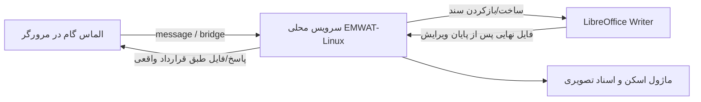

# تحلیل گردش‌کار واقعی EMWAT در الماس گام

تاریخ ثبت: 2026-11-12؛ بازبینی: 2026-11-14  
وضعیت: ترکیب شواهد ایستای نسخه Windows و توضیحات کاربر؛ جزئیات پروتکل هنوز runtime-validated نیست.

## 1. تعریف محصول بر اساس استفاده واقعی

EMWAT در سناریوی اصلی، یک واسط محلی بین سامانه اتوماسیون تحت وب «الماس گام» و برنامه‌های دسکتاپ کاربر است. نقش اصلی آن صرفاً اسکن یا ویرایش تصویر نیست؛ مهم‌ترین گردش‌کار شناخته‌شده، تولید و ویرایش نامه در Word و تبادل نتیجه با اتوماسیون است.

مرجع تنظیمات و ذخیره‌سازی نامه، خود سامانه الماس گام است. قالب‌ها و مشخصات نامه نیز در همان سامانه تنظیم می‌شوند، نه در یک پایگاه داده مستقل که فعلاً برای EMWAT فرض کنیم.

## 2. گردش‌کار نامه متنی — تأییدشده از توضیح کاربر

1. کاربر در اتوماسیون تحت وب الماس گام، ایجاد یا ویرایش نامه را آغاز می‌کند.
2. از طریق سرویس EMWAT روی سیستم کاربر، Word اجرا می‌شود.
3. اطلاعات نامه و قالبی که در الماس گام تنظیم شده‌اند در سند اعمال می‌شوند؛ نمونه‌های گفته‌شده شامل موضوع، نام امضاکنندگان، شماره نامه، سربرگ، لوگو، فونت، حاشیه‌ها و محل امضاها هستند.
4. کاربر متن اصلی نامه و بخش‌های قابل ویرایش را در Word تکمیل یا اصلاح می‌کند.
5. پس از پایان کار و بستن Word، فایل نهایی به اتوماسیون الماس گام بازگردانده و در همان سامانه ذخیره می‌شود.

### مشاهده کاربر درباره Save/Close — تأییدشده در سطح رفتار محصول

کاربر این رفتار را شخصاً آزمایش کرده است: با بستن سند، اعمال/ثبت تغییرات انجام می‌شود؛ چه پیش از بستن Save زده شده باشد و چه نشده باشد. بنابراین این رفتار، الزام قطعی برای بازسازی نسخه Linux است و نباید دوباره به‌عنوان سؤال یا فرضیه مطرح شود.

آنچه هنوز نامشخص است، سازوکار داخلی آن است: آیا EMWAT پیش از بسته‌شدن فایل را به‌صورت silent ذخیره می‌کند، از COM محتوای جاری را می‌خواند، از رویداد BeforeClose استفاده می‌کند یا مسیر دیگری دارد. همچنین رفتار Cancel، بستن اجباری و crash هنوز جداگانه اعتبارسنجی نشده‌اند. مشاهده کاربر، رفتار محصول را تأیید می‌کند؛ اما به‌تنهایی event یا transport دقیق را مشخص نمی‌کند.

## 3. گردش‌کار نامه تصویری — دامنه احتمالی

برخی نامه‌ها تماماً تصویری هستند. کاربر تاکنون بیشتر مصرف‌کننده/خواننده این نوع نامه‌ها بوده و هنوز ساختن یا ویرایش آن‌ها را شخصاً آزمایش نکرده است. امکان حذف یا اضافه‌کردن صفحات از نظر کاربر محتمل است، اما تأیید نشده است.

بنابراین قابلیت‌های تصویر و اسکن باید در پروژه حفظ شوند، ولی رفتارهای تأییدنشده مانند ساخت سند تصویری، حذف/افزودن صفحه یا بازگرداندن آن‌ها به اتوماسیون باید در وضعیت «نیازمند بررسی» بمانند.

## 4. شواهد فنی موجود از bridge محلی

در رشته‌های استخراج‌شده از EmwatService.exe یک اسکریپت JavaScript قابل‌بازیابی دیده شده که:
- پیام‌های message را با window.addEventListener دریافت می‌کند و برای مرورگرهای قدیمی مسیر attachEvent نیز دارد.
- داده پیام (event.data) را با XMLHttpRequest و متد POST به آدرس loopback با الگوی http://127.0.0.1:$V{myport}?invoke=<random> می‌فرستد.
- مقدار responseText را با postMessage به source اولیه و origin اولیه برمی‌گرداند.
- در شروع، پیام <inited /> را به parent و host جایگزین‌شده در زمان اجرا می‌فرستد.
- پورت 1984 در رشته خطای bind به‌عنوان پورت پیش‌فرض/مورد انتظار build دیده می‌شود؛ heartbeat نیز در رشته‌های Agent با مسیر /?heartbeat دیده شده است.

این شواهد وجود یک bridge پیام دوطرفه مبتنی بر HTTP محلی را تقویت می‌کنند. اما هنوز body دقیق درخواست، encoding، قرارداد پاسخ، نام متدهای فراخوانی‌شده، مدیریت فایل، احراز هویت و تمام endpointها استخراج یا در runtime مشاهده نشده‌اند.

## 5. یافته تکمیلی از RTTI و نمادهای BPL

تحلیل نمادهای EmwatMethods.bpl1 اکنون کلاس TEditWordDocument.PerformMethod، dispatcher عمومی TEmwatMethod، Wordviewer.OpenDoc و مدل‌های XML درخواست/پاسخ Word را نشان می‌دهد. Word request دارای Body، Fields، Settings، Permission، ViewMode و RequestedTypes است و مدل Style شامل FontName، FontSize، FontStyle، Align و Valign است. همچنین handlerهای SilentSaveEmwatDoc، OnTmrAutoSave، WordAppDocumentBeforeClose و WordAppDocumentBeforeSave دیده شده‌اند. این شواهد وجود ساختار داده و lifecycle ذخیره‌سازی را تقویت می‌کنند، اما wire format و زمان دقیق ارسال هنوز باید در runtime بررسی شود. جزئیات در [تحلیل پروتکل Word](WORD-DOCUMENT-PROTOCOL-ANALYSIS.md) آمده است.

## 6. معماری هدف برای Linux

این نمودار معماری هدف است، نه ادعای پیاده‌سازی موجود.

### اصول طراحی

1. ابتدا قرارداد واقعی پیام‌های مرورگر و سرویس Windows استخراج شود؛ API جدید نباید با حدس ساخته شود.
2. سرویس Linux باید روی loopback محدود شود و payload، اندازه فایل، timeout و دسترسی محلی را کنترل کند.
3. لایه bridge از موتور سند و از پیاده‌سازی LibreOffice جدا باشد.
4. سازگاری سند باید با قالب‌های واقعی الماس گام سنجیده شود؛ DOC/DOCX، bookmark، فیلدها، سربرگ، امضا و فونت‌ها جداگانه تست شوند.
5. چرخه عمر سند (بازشدن، چند سند هم‌زمان، ذخیره، بستن، لغو، crash و بازگرداندن فایل) باید صریح و قابل‌آزمایش باشد.
6. ماژول اسکن و تصویر حفظ شود؛ گردش‌کار آن تا زمان آزمایش واقعی به‌عنوان حوزه در حال کشف ثبت شود.
7. هیچ پایگاه داده محلی یا منبع مرجع مستقلی برای نامه‌ها فرض نشود؛ اطلاعات فعلاً از الماس گام می‌آیند و ذخیره نهایی نیز در همان سامانه انجام می‌شود.

## 7. اولویت‌های اجرایی بازتنظیم‌شده

### P0 — شناخت و اثبات قرارداد ارتباطی
- استخراج dispatch متدها از EmwatMethods.bpl1 و اتصال آن‌ها به پیام‌های bridge.
- تعیین payload واقعی، encoding، پاسخ موفق/خطا و نحوه انتقال فایل.
- ثبت رفتار heartbeat، انتخاب پورت و init script.
- گرفتن trace شبکه/فایل از یک سناریوی واقعی الماس گام، بدون ثبت اطلاعات محرمانه یا محتوای نامه واقعی.

### P1 — نمونه انتها‌به‌انتها برای نامه متنی
- دریافت یک درخواست نمونه و پاسخ mock.
- تولید یک سند نمونه با داده ساختگی و قالب کنترل‌شده.
- بازکردن آن در LibreOffice Writer.
- تشخیص پایان کار و جمع‌آوری فایل؛ سپس شبیه‌سازی پاسخ به caller.
- پس از اثبات قرارداد، اتصال واقعی به الماس گام.

### P2 — چرخه سند و سازگاری قالب
- bookmark/field، قالب‌بندی، سربرگ، لوگو، امضا، فونت و صفحه‌بندی.
- چند سند هم‌زمان، cancel، crash recovery و فایل‌های موقت.
- آزمون‌های regression با نمونه‌های بی‌خطر و غیرمحرمانه.

### P3 — نامه‌های تصویری و اسکن
- حفظ ImageDocument و SANE backend موجود.
- تعیین قالب ورودی/خروجی تصویر و چندصفحه‌ای.
- آزمایش واقعی مشاهده، ساخت، افزودن/حذف/مرتب‌سازی صفحات و بازگرداندن فایل، در صورت پشتیبانی محصول اصلی.

### P4 — بسته‌بندی و استقرار
- سرویس user-session یا system service بر اساس رفتار واقعی نسخه Windows.
- نصب/حذف، startup، logging، به‌روزرسانی و hardening.
- بسته‌بندی و مستندات توزیع‌های هدف.

## 8. کمک موردنیاز از کاربر برای آزمایش واقعی

در زمان مناسب یک نامه آزمایشی با اطلاعات ساختگی در الماس گام ایجاد شود و فقط این موارد ثبت شوند:
- آیا Word بلافاصله باز می‌شود یا ابتدا دانلود/فایل موقت ساخته می‌شود؟
- نام و پسوند فایل موقت، بدون ارسال محتوای محرمانه.
- آیا پس از Save و بستن، نامه برمی‌گردد؟
- آیا بدون Save و بستن هم آخرین تغییرات برمی‌گردند؟
- آیا هنگام بستن prompt ذخیره ظاهر می‌شود؟
- پس از بازگشت، سند در الماس گام قابل مشاهده/دانلود است؟
- آیا چند نامه می‌توانند هم‌زمان باز باشند؟

هر trace یا فایل نمونه باید پیش از اشتراک‌گذاری از نام اشخاص، شماره نامه واقعی، متن محرمانه، token، cookie و URL خصوصی پاک‌سازی شود.

## 9. مرزبندی وضعیت‌ها

- **تأییدشده از کاربر:** Word از طریق سرویس محلی در جریان ایجاد/ویرایش نامه باز می‌شود؛ اطلاعات و قالب در الماس گام تنظیم می‌شوند؛ کاربر متن را ویرایش می‌کند؛ نتیجه پس از پایان کار به الماس گام برمی‌گردد؛ بعضی نامه‌ها تماماً تصویری‌اند.
- **شواهد ایستا:** HTTP bridge روی loopback، پیام‌رسانی postMessage، POST به مسیر invoke، پاسخ responseText و init marker.
- **نیازمند runtime validation:** قرارداد کامل invoke، انتقال فایل، رفتار دقیق Save/Close، heartbeat کامل، چندسندی، احراز هویت و تمام workflowهای تصویر.
- **هنوز پیاده‌سازی نشده:** سرویس سازگار Linux و یکپارچگی واقعی با الماس گام و LibreOffice.

## Word close lifecycle correction — run 26 (2026-11-14)

The previous static notes mention WordAppDocumentBeforeClose and WordAppDocumentBeforeSave, but their address mapping has since been corrected. The callback pointer at event-record offset +0x80 targets 0x004CD154, whose TD32 symbol is TWordViwer.WordAppDocumentBeforeSave. That symbol is not sufficient to establish the formal COM event DISPID: its first diagnostic says Document.OnBeforeClose Called. and its body invokes the three-argument Word Document.Close wrapper. The separately named TD32 procedure WordAppDocumentBeforeClose is 0x004CCBBC, with only one direct bounded caller found (FillImgFldsForPrint at 0x004CCF8F) and no raw-pointer registration reference. Therefore the formal event identity remains unresolved; use the neutral label “registered close/save-decision callback at 0x004CD154”.

The callback at 0x004CD154 accesses the Word document interface, conditionally prompts, sets the event Cancel value on Cancel, and invokes the three-argument Close interface path for Yes/No. Its TD32 name is BeforeSave, but the event-record slot's formal COM DISPID is not yet proven. Also, the wrapper crosswalk maps Get_Saved to slot +0xD4 and Set_Saved to +0xD8; do not describe an access through +0xD8 as reading Saved. This does not disprove the user's observed behavior: closing the document applies/registers changes even when Save was not pressed. That behavior remains a required product contract; the page-side POST/response path is still the likely place to connect the observed close event to the web application, but the exact mechanism is not yet established.

## Clarification from repeat user test — close without pressing Save (2026-11-14)

The user repeated the test and confirmed again that the letter is registered/appears in Almas Gam after closing Word even when the user never presses the Save button. This is now a repeated direct observation and a firm product requirement.

Important distinction: this observation proves the end-to-end result (close Word → the file is present/registered in Almas Gam); it does **not** prove that Word's underlying document was never saved. A plausible sequence is that EMWAT or Word performs a save/silent-save as part of the close sequence, then EMWAT returns the resulting document/configuration to the browser through the existing HTTP response path. Another implementation is possible; the internal sequence remains unverified.

For reverse engineering, explicitly separate these questions:
1. Does Word save the active document automatically or via an EMWAT-issued COM command during close?
2. What exact artifact/state does EMWAT collect after that save/close?
3. How does the local HTTP response deliver it to the browser, and how does Almas Gam persist it?

Do not describe the observed behavior as “upload without saving”. The correct verified wording is: **the user does not press Save, but closing Word is sufficient for the document to be registered in Almas Gam**.

## 2026-11-25 — decision contract cross-reference

The user's Windows observation remains: closing Word is sufficient for Almas Gam registration even when the user does not press the toolbar Save button. This does not mean every close choice returns unsaved bytes. The required Linux decision semantics are now specified separately: Save returns the latest successfully saved snapshot; Don't Save returns the previous approved snapshot; Cancel keeps the same session open and the pending request waiting. See [Word close/response contract reconciliation](WORD-CLOSE-RESPONSE-CONTRACT-2026-11-25.md). The Windows prompt's formal COM event identity and exact wire mapping remain under investigation.
